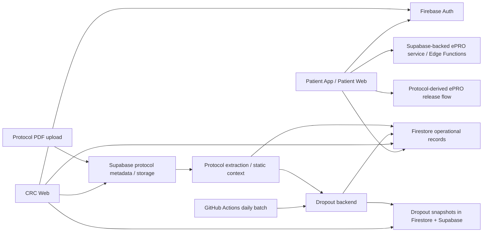
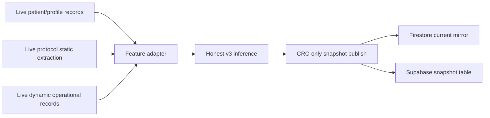

# TrialLight Full Workflow And Current Status

## 1. Purpose Of This Document

This document is a supervisor-facing engineering and product workflow report for the entire
TrialLight integration workspace.

It is intended to answer five practical questions:

1. What the TrialLight system currently is.
2. How the major surfaces and services connect end-to-end.
3. What has already been implemented and stabilized.
4. What is still incomplete, risky, or intentionally deferred.
5. What areas a supervisor could most usefully critique or improve.

This document is broader than the dropout-only reports under
`Patient-Dropout-Prediction/`. It covers:

- the CRC web surface
- the patient mobile/web surface
- the ePRO/questionnaire flow
- the safety/incident workflow
- the protocol upload and metadata path
- the dropout prediction integration path
- the current deployment and operational topology

It should be read together with these narrower technical references when needed:

- `PLAN.md`
- `SUPABASE_NO_RENDER_PREP.md`
- `TEAMMATE_TEST_DEPLOYMENT.md`
- `Patient-Dropout-Prediction/FULL_HISTORY_AND_STATUS_REPORT.md`
- `Patient-Dropout-Prediction/OFFICIAL_MODEL.md`
- `Patient-Dropout-Prediction/EVIDENCE_PACK.md`
- `Patient-Dropout-Prediction/TESTING_START_RUNBOOK.md`

## 2. Executive Summary

TrialLight is currently a multi-surface v1 system organized around a strict product boundary:

- the root web application is the CRC-only operational surface
- the Expo application is the patient-only surface
- ePRO is a patient workflow with a separate service/backend ownership boundary
- dropout prediction is CRC-only and must never be shown to patients

The repository is not one monolith in the product sense. It is an orchestration workspace
that coordinates multiple active but distinct runtime slices.

From an engineering maturity perspective, the project is now past the "prototype with unclear
boundaries" stage. The main flows have been separated and stabilized. Specifically:

- the CRC web and patient app now have explicit role boundaries
- ePRO is integrated as a real patient-side capability, not just a standalone demo
- CRC has dedicated operational visibility for safety, patient management, protocol, and ePRO
- dropout prediction has progressed from placeholder integration to a frozen pre-testing
  official model line (`Honest v3`)
- the long-term architecture has shifted away from a Render-first path toward a
  Firebase + Supabase + GitHub Actions architecture

However, TrialLight should still be described honestly as:

- a v1 integration system
- appropriate for supervised pre-testing and workflow validation
- not yet validated by sustained real-world patient usage
- not a diagnosis system
- not a substitute for direct emergency escalation or clinical judgment

## 3. Repository Scope And Product Boundaries

### 3.1 Root Workspace Role

This root folder is an integration workspace, not a signal to collapse every workstream into
one runtime.

The active source trees are:

- `src/`, `public/`, root `package.json`: CRC web
- `MyClinicalApp_AndroidAPK_5Jan2026_2138/MyClinicalApp2/app/`: Expo router entrypoints
- `MyClinicalApp_AndroidAPK_5Jan2026_2138/MyClinicalApp2/src/`: patient app logic
- `li qiu's part questionnaire ePRO/server_integrated.js`: legacy/local parity ePRO service
- `Patient-Dropout-Prediction/src/`: dropout prediction backend and integration contracts

### 3.2 Locked V1 Product Boundary

The following rules are intentionally locked for v1:

- Root website is CRC-only.
- Mobile app is patient-only.
- ePRO is a patient-app feature.
- Dropout prediction output is CRC-only.

The patient surface must never expose:

- dropout probability
- risk bucket
- action priority
- recommended CRC action
- explanation signals

### 3.3 Why These Boundaries Matter

These boundaries were introduced because the early workspace mixed:

- CRC and patient UI concerns
- demo and production-intended paths
- research/runtime dropout work
- standalone ePRO development and integrated ePRO usage

Without these boundaries, the system was difficult to reason about, demo, or defend.

## 4. Users, Roles, And High-Level Use Cases

### 4.1 CRC User

Primary responsibilities:

- monitor patients
- review side effects and urgent incidents
- manage patient registry and protocol assignment
- review ePRO readiness and status
- view dropout risk outputs and act on them operationally

CRC does not:

- answer ePRO as a patient
- see raw dropout internals beyond operational explanation signals
- use the patient mobile app as the main surface

### 4.2 Patient User

Primary responsibilities:

- register and maintain their own profile
- log vitals
- report side effects
- answer ePRO
- review appointments
- interact with the support/chat layer

Patient does not:

- see dropout risk
- see CRC-only operational explanations
- use the CRC web as a patient-facing portal

### 4.3 Supervisor / Evaluator / Teammate

Likely concerns:

- whether the workflow makes clinical and operational sense
- whether data flows are role-safe
- whether AI outputs are constrained appropriately
- whether dropout prediction is honest about its evidence and limitations
- whether the system is ready for real-user testing

## 5. System Architecture Overview

### 5.1 Current Preferred Architecture

### 5.2 Platform Responsibilities

#### Firebase

Used for:

- Auth
- Firestore operational records
- Hosting for CRC web
- Hosting for patient web

#### Supabase

Used for:

- protocol PDF storage and retrieval helpers
- ePRO runtime storage/state
- dropout snapshot storage
- migration-managed data objects
- Edge Function hosting for selected backend behaviors

#### GitHub Actions

Used for:

- scheduled daily dropout precompute publishing

#### Local Python Backend

Used for:

- dropout model training
- evaluation
- data generation
- precompute publishing logic
- local research and contract integration

## 6. Identity, Ownership, And Data Boundaries

### 6.1 Canonical Identity

The canonical integration identity is:

- `subject_id`

Temporary fallback when needed:

- Firebase `user.uid`

### 6.2 Ownership Rules

- ePRO detailed questionnaire generation/submission logic belongs to the questionnaire service
- Firestore `users/{uid}/epro_submissions/*` is the mirrored operational layer for CRC visibility
- dropout prediction consumes operational inputs and produces CRC-only outputs
- patient app must not depend on dropout internals
- CRC web must not depend on questionnaire service internals

### 6.3 Why Mirrored Operational Layers Exist

The project intentionally uses mirrored operational layers instead of direct coupling so that:

- CRC can see status without owning the entire backend logic
- patient and CRC flows stay role-safe
- integration remains resilient even if the underlying service implementation changes

## 7. CRC Web Workflow

### 7.1 CRC Web Purpose

The CRC web app is the operational control surface for:

- patient roster and study context
- safety review and incident documentation
- protocol management
- ePRO review/visibility
- dropout risk visibility
- resource lookup

### 7.2 CRC Shell And Navigation

The CRC shell has been stabilized around a clear section-based layout instead of scattered pages.

Recent UX work moved the information architecture toward:

- a cleaner sidebar structure
- a dedicated ePRO section
- a clearer split between urgent work, safety inbox, and archived history
- removal of duplicated page-level hero headers
- a more explicit shell header as the single source of page meaning

### 7.3 Main CRC Sections

Current major sections include:

- Dashboard
- Patients
- Safety Inbox
- Clinical Intelligence
- Protocol Library
- Study Coordination
- Patient Dropout Prediction
- ePRO
- Resources

### 7.4 Dashboard

Purpose:

- give CRC an overview of operational status
- allow quick transition into urgent tasks
- keep the selected patient and study context visible

### 7.5 Patients

Purpose:

- patient roster review
- context switching between patients
- handoff and study-linked operational navigation

### 7.6 Safety Inbox / Urgent / History

This area went through a major information architecture clean-up.

Current intended roles:

- `Urgent`: quick launcher for immediate urgent items
- `Safety Inbox`: the main structured safety workflow workspace
- `History`: archive/audit view inside Safety Inbox, not a competing top-level workflow

This separation matters because earlier designs overused the term 鈥渁lerts鈥?and made it difficult
for CRCs to distinguish:

- immediate response work
- structured safety case handling
- archived thread lookup

### 7.7 Safety Documentation

Within Safety Inbox, CRC documentation is intended to capture:

- what happened
- what CRC reviewed
- whether the case has been acknowledged
- whether it has been resolved
- what follow-up was performed

The current implementation is still closer to a v1 note/status model than a full
longitudinal case-management timeline.

### 7.8 Protocol Library

Purpose:

- manage protocol-associated configuration
- keep built-in monitored vitals stable
- define or review protocol-linked operational content

Recent refinements included:

- accordion behavior
- better text input visibility
- stronger constraints on monitored vital types

### 7.9 Study Coordination

Purpose:

- coordinate patient-study configuration
- manage subject-level operational details
- review appointments and non-ePRO study operations

Some earlier ePRO operational visibility that originally lived here has been moved into the
dedicated ePRO section for clarity.

### 7.10 ePRO Section

The CRC ePRO workspace is now intended to be the single CRC-facing location for:

- pending trial review
- pending patient review
- released today
- submitted / overdue
- operational status visibility

The design direction is:

- CRC reviews daily questionnaire drafts before patient release
- CRC can approve or wording-edit where allowed
- patient only sees released questionnaires

This is a stronger operational workflow than the earlier passive status panel.

### 7.11 Patient Dropout Prediction Section

Purpose:

- show CRC-only risk outputs
- prioritize operational review
- present risk in an explainable, non-diagnostic manner

The dropout panel currently centers around:

- `dropout_probability`
- `risk_bucket`
- `recommended_action`
- quality/confidence indicators
- explanation signals based on available operational inputs

The goal is risk ranking and CRC prioritization, not autonomous decision-making.

## 8. Patient App Workflow

### 8.1 Patient App Purpose

The patient app is the active patient-facing operational surface.

Its job is to collect live patient-side operational data while keeping the experience
usable and role-safe.

### 8.2 Core Patient Flows

Current major patient flows include:

- sign-in / registration
- profile editing
- DOB capture
- vitals logging
- side effect reporting
- appointments
- ePRO answer flow
- support/chat interactions

### 8.3 Registration And Profile

Patient profile data now matters not only for UX but also for live system inputs.

Important fields include:

- DOB
- patient profile information
- newer dropout-relevant live static fields:
  - `caregiver_support`
  - `distance_to_site_km`

DOB is used as the runtime source for derived age in the dropout pipeline.

### 8.4 Vitals

Vitals are a major operational input for:

- patient monitoring
- possible side effect escalation
- ePRO customization
- dropout behavior signals

Live source:

- `users/{uid}/vitals`

### 8.5 Side Effect Reporting

Patient-reported side effects feed:

- symptom guidance
- incident creation and escalation
- structured safety review
- dropout feature engineering

Live source:

- `users/{uid}/side_effect_reports`

### 8.6 Appointments

Appointments are part of both operational care coordination and dropout feature generation.

Live source:

- `users/{uid}/appointments`

Signals derived include:

- appointment adherence
- missed appointments
- operational activity continuity

### 8.7 Chat / Follow-Up Layer

The system鈥檚 support/chat flow is not intended to replace emergency care.

Its real value is:

- structured support communication
- documentation
- response tracking
- possible integration into dropout operational responsiveness features

### 8.8 ePRO Patient Experience

Patient ePRO is designed as:

- protocol-owned base and conditional questions
- possible customized questions informed by live context

The current rule set intentionally excludes dropout risk from question generation.

Customized questions should be influenced by:

- chat history
- vitals
- side effects

not by dropout risk.

This separation matters because dropout prediction should consume operational data,
not silently shape what data gets asked in a circular way.

## 9. ePRO Workflow In Detail

### 9.1 ePRO Product Role

ePRO is not just a questionnaire demo. It is now a system input source and a patient workflow.

Its outputs feed:

- patient care monitoring
- CRC operational visibility
- dropout dynamic features, especially:
  - ePRO completion status
  - pain
  - anxiety

### 9.2 Question Structure

There are two major question layers:

1. protocol-owned baseline questions
2. customized questions

Protocol-owned questions:

- are derived from the protocol/baseline config
- include base questions and their conditional follow-ups
- remain the primary questionnaire backbone

Customized questions:

- are limited in count
- are constrained in type
- should not replace the protocol backbone
- are driven by live operational context

### 9.3 Removal Of Dropout-Risk-Driven Questioning

One important design correction was to remove dropout risk as an input to ePRO question generation.

Reason:

- dropout should use ePRO as an input
- ePRO should not be distorted by dropout output
- otherwise the system risks circular reasoning and weak clinical interpretability

### 9.4 Anxiety As A First-Class Signal

Anxiety was elevated into formal ePRO logic rather than inferred indirectly from text alone.

This improved:

- clarity of questionnaire structure
- structured pain/anxiety extraction
- usefulness for dropout feature engineering

### 9.5 CRC Review-And-Release Flow

The ePRO direction evolved further toward:

- daily pre-generation
- CRC preview / approval
- patient release only after approval or auto-release conditions

This makes ePRO more operationally controlled and study-friendly.

### 9.6 Firestore Operational Mirror

CRC and dropout do not need the full private internals of questionnaire generation.

Instead, the operational mirror under:

- `users/{uid}/epro_submissions/{formId}`

is used as the stable integration layer.

This mirror now also serves the dropout pipeline by carrying structured answer summaries such as:

- status
- pain score
- anxiety score
- question/release metadata

## 10. Protocol Upload And Static Context Extraction Workflow

### 10.1 Why Protocol Upload Matters

Protocol upload is no longer only a document management feature.

It now influences:

- protocol-linked ePRO behavior
- protocol-derived live static context for dropout prediction

### 10.2 Long-Term Intent

When a protocol PDF is uploaded, the system should:

1. store or link the document
2. extract structured protocol metadata
3. persist normalized fields
4. make them available to downstream consumers

### 10.3 Dropout-Relevant Protocol Static Context

The newer fully-live dropout direction requires protocol-derived static fields such as:

- `trial_phase`
- `condition_family`
- `enrollment`
- `criteria_complexity`
- intervention flags:
  - device
  - drug
  - behavioral
  - procedure

These are intended to be extracted at upload time and stored on protocol records
as live operational metadata rather than looked up from a frozen registry.

### 10.4 Current Caveat

The protocol extraction QA process is prepared but not fully completed on a real 25-protocol
sample because a local shell credential requirement blocked the real audit export.

So this path is architecturally in place, but still needs more empirical QA.

## 11. Safety, Incident, And Emergency Workflow

### 11.1 Intended Positioning

TrialLight should never be presented as:

- autonomous emergency care
- a substitute for direct emergency calling
- diagnosis

Its safety layer is instead:

- structured documentation
- faster operational triage
- better CRC follow-up
- study-linked traceability

### 11.2 Incident Workflow

The major intended path is:

1. patient reports symptoms or operational concern
2. signal may trigger or sync into a structured incident record
3. CRC sees it through Urgent / Safety Inbox
4. CRC documents review and action
5. case is acknowledged and eventually resolved

### 11.3 Why This Matters For Dropout

Safety and engagement are not separate worlds.

In the current dropout design, safety-linked signals matter because:

- persistent symptoms
- emergency incidents
- unaddressed follow-up
- disengagement after symptomatic burden

are all plausible precursors to study dropout or operational disengagement.

## 12. Dropout Prediction Workflow In Detail

### 12.1 What The Dropout Component Is

The dropout prediction subsystem is a CRC-only operational risk ranking tool.

It is designed to identify patients who appear more likely to disengage from study participation
or operational follow-up, so CRCs can review and intervene earlier.

### 12.2 What It Is Not

It is not:

- a diagnosis model
- a clinical deterioration detector in the strict medical sense
- a guarantee that a patient will drop out

### 12.3 Historical Evolution

The dropout workstream went through several major phases:

1. placeholder/adapter visibility only
2. frozen subject lookup path
3. live dynamic-feature integration
4. ePRO-to-dropout linkage
5. static-context live-ification
6. honest retraining and official model freeze
7. pre-testing stabilization

The dropout-only historical narrative is documented in detail in:

- `Patient-Dropout-Prediction/FULL_HISTORY_AND_STATUS_REPORT.md`

### 12.4 Current Official Model State

Current official model line:

- `Honest v3`

Current positioning:

- pre-testing official model
- recall-first operational policy
- challenger-aware evaluation against logistic baseline

### 12.5 Current Runtime Intent

Long-term intended runtime path:

### 12.6 Dynamic Features

Dynamic features are now largely designed to come from live operational data:

- vitals
- appointments
- ePRO status
- pain/anxiety
- side effects
- incidents
- CRC follow-up and replies
- activity timing features

### 12.7 Static Features

The project moved away from pretending frozen static registries were an acceptable long-term
solution. The intended fully-live schema centers on:

- patient-level live fields:
  - age derived from DOB
  - caregiver support
  - distance to site
- protocol-derived live fields:
  - trial phase
  - condition family
  - enrollment
  - criteria complexity
  - intervention flags

### 12.8 Honest Evaluation Principle

A major correction in the dropout workstream was to stop overstating offline performance.

Important changes included:

- honest train / validation / test separation
- validation-based policy selection
- explicit transformer vs logistic comparison
- reduced reliance on hidden synthetic-only assumptions
- clearer explanation of what the model can and cannot prove before real-user testing

### 12.9 Current Limitation

Because there has not yet been a real testing phase with daily real-user data,
the project does not yet have:

- real-world outcome validation
- sustained shadow monitoring evidence
- meaningful proxy evaluation on real operational cohorts

That means the dropout model should be described as:

- operationally structured
- relatively honest
- better aligned to live runtime than before
- not yet validated by real patient behavior over time

## 13. Data Layer Breakdown

### 13.1 Firestore

Operational owner for many live records:

- users
- vitals
- appointments
- side effect reports
- alerts/messages
- incident-linked mirrors
- ePRO operational mirrors
- dropout current mirrors

### 13.2 Supabase

Operational owner or support layer for:

- ePRO detailed state
- protocol storage and extraction helpers
- dropout snapshot storage
- migration-managed tables

### 13.3 Mirrored vs Source-Of-Truth Model

The project deliberately does not place every detail in one database.

Instead it uses:

- source-of-truth backends for specialized logic
- Firestore mirrors for CRC-facing operational visibility

This is a practical v1 integration strategy, but it also increases the need for careful contract management.

## 14. Deployment And Runtime Topology

### 14.1 Frontend Hosting

CRC web:

- hosted from root `dist`
- Firebase Hosting target: `crc`
- public URL: `https://triallight.web.app`

patient web:

- built from Expo export to `MyClinicalApp_AndroidAPK_5Jan2026_2138/MyClinicalApp2/web-build`
- Firebase Hosting target: `patient`
- public URL: `https://triallight-patient.web.app`

### 14.2 Root Frontend Build Scripts

Root scripts of interest:

- `npm run dev`
- `npm run build:crc`
- `npm run build:patient-web`
- `npm run build:shareable`
- `npm run deploy:hosting`

### 14.3 Patient App Scripts

Patient app scripts of interest:

- `npm run start`
- `npm run android`
- `npm run ios`
- `npm run web`
- `npm run export:web`

### 14.4 ePRO Service Runtime

Historically, the local/reference entrypoint is:

- `li qiu's part questionnaire ePRO/server_integrated.js`

The preferred long-term production direction is Supabase-backed ePRO behavior and Edge Functions.

### 14.5 Dropout Publishing Runtime

The preferred long-term direction is:

- GitHub Actions daily batch
- Firestore CRC-only mirrors
- Supabase snapshot storage

instead of a public always-on dropout HTTP service as the main operational path.

## 15. Major Engineering Milestones Already Completed

This section summarizes major accomplishments across the system at a higher level than the raw log.

### 15.1 Workspace Governance And Product Boundary Cleanup

Completed:

- active vs legacy tree separation
- CRC-only vs patient-only boundary
- explicit AGENTS and PLAN governance
- role-safe product framing

### 15.2 CRC Surface Maturity Improvements

Completed or mostly completed:

- clearer section shell
- stronger sidebar structure
- safety information architecture cleanup
- ePRO moved to dedicated CRC section
- protocol and patient management refinements

### 15.3 Patient Workflow Maturity Improvements

Completed or mostly completed:

- stronger profile / DOB handling
- ePRO integration into patient flow
- improved collection of live operational signals
- support for newer static fields for dropout

### 15.4 ePRO Maturity Improvements

Completed or mostly completed:

- normalization around daily survey / submit contracts
- patient integration path
- removal of dropout-risk-driven question generation
- structured pain/anxiety summary path
- CRC review-and-release architecture

### 15.5 Dropout Maturity Improvements

Completed:

- official model line freeze (`Honest v3`)
- live dynamic feature path
- stronger static live schema direction
- honest evaluation cleanup
- official evidence pack
- demo scenario pack
- testing-start runbook
- full dropout-only historical report

## 16. Current State By Subsystem

### 16.1 CRC Web

Current state:

- operationally strong v1 surface
- multiple workflows are implemented and demonstrable
- still vulnerable to complexity creep if more features are added without IA discipline

### 16.2 Patient App

Current state:

- viable patient-facing operational surface
- collects important live signals
- still needs real-user testing to prove usability and adherence

### 16.3 ePRO

Current state:

- much stronger than the original standalone demo concept
- structurally integrated into patient and CRC workflows
- still needs more real-world cadence validation and operational testing

### 16.4 Protocol Extraction

Current state:

- strategically important
- partially validated in design
- not yet fully QA-audited on a strong real sample

### 16.5 Dropout Prediction

Current state:

- best described as frozen pre-testing official version
- significantly improved in honesty and live compatibility
- not yet real-world validated

## 17. What Is Already Good And Worth Defending

These are areas where the system now has a coherent story:

### 17.1 Clear Product Separation

The CRC/patient/ePRO/dropout boundaries are much clearer than in the early mixed state.

### 17.2 Strong Role Safety

Especially important:

- dropout stays CRC-only
- patient does not see internal risk outputs
- ePRO has its own ownership boundary

### 17.3 Live-Data Direction

The project has moved away from pretending that frozen research assets are an acceptable
final runtime design.

### 17.4 Honest Dropout Positioning

The model is now easier to defend because it is presented as:

- operational risk support
- not diagnosis
- pre-testing official model
- still awaiting real-world validation

### 17.5 Workflow Thinking Over Pure Feature Accumulation

The strongest engineering decisions in this workspace came from workflow clarification:

- safety inbox vs urgent vs history
- ePRO release flow
- CRC-only vs patient-only surfaces
- mirrored operational layers

## 18. Main Risks, Weaknesses, Or Criticisms A Supervisor Could Reasonably Raise

This section is intentionally candid.

### 18.1 No Real-World Outcome Validation Yet

This is the biggest unavoidable limitation.

The system currently lacks:

- a real patient cohort
- sustained live behavioral traces
- real dropout labels

### 18.2 Protocol Extraction Reliability Is Not Fully Proven

If protocol-derived static context is wrong, both ePRO logic and dropout inputs can drift.

### 18.3 V1 Complexity Risk

The workspace is powerful but broad:

- CRC workflow
- patient workflow
- ePRO
- AI guidance
- protocol extraction
- dropout prediction

That means the product can become harder to explain and harder to test unless the team keeps
the scope disciplined.

### 18.4 Mirrored Data Contracts Increase Coordination Cost

Mirrors are a reasonable v1 strategy, but they also create risks:

- drift between source-of-truth and mirror
- confusion over who owns which field
- extra QA burden

### 18.5 Safety Positioning Must Stay Conservative

Because the product involves symptoms, alerts, and follow-up, presentation matters.

The system should never be marketed as:

- AI triage replacing clinician judgment
- emergency escalation replacement
- a clinically validated dropout predictor

## 19. Most Valuable Improvement Questions To Ask A Supervisor

If this document is being used to request supervisor feedback, these are likely the highest-value questions.

### 19.1 Product And Workflow

- Is the current separation between CRC web and patient app correct, or does any workflow still feel artificially split?
- Is the new `Urgent / Safety Inbox / History` structure easy enough for first-time CRC users?
- Is the ePRO review-before-release idea clinically sensible, or too operationally heavy?
- Does the current patient journey feel realistic for early-phase deployment?

### 19.2 Clinical And Operational Validity

- Are the current ePRO question-generation rules clinically reasonable?
- Are the protocol-derived static fields for dropout sensible, or are some conceptually weak?
- Is the dropout system framed appropriately as an operational prioritization tool rather than a clinical predictor?

### 19.3 Data And Validation

- Which real-world signals should be considered the minimum required before claiming dropout usefulness?
- What proxy outcomes would a supervisor consider acceptable during early testing?
- Which parts of protocol extraction most need human QA?

### 19.4 Scope And Prioritization

- Which subsystem is most valuable to stabilize before real-user testing?
- Which subsystem is overbuilt relative to current validation capacity?
- What should be postponed until after the first real testing phase?

## 20. What Still Seems Missing Or Most Worth Doing Next

If the goal is to improve the project before or during the next phase, these are the strongest candidates.

### 20.1 Before Real Testing Starts

Best next steps:

- finish protocol static-context QA on a real sample
- tighten demo materials and supervisor-facing narrative
- keep dropout official model frozen
- avoid unnecessary new feature growth

### 20.2 Once Real Testing Starts

Then it becomes appropriate to:

- enable shadow prediction accumulation
- run proxy evaluation
- measure real adherence and engagement
- assess whether recalibration or retraining is justified

### 20.3 What Should Not Be Reopened Lightly

These should not be casually reopened unless strong evidence appears:

- role boundary between CRC and patient surfaces
- the principle that dropout is CRC-only
- the honest framing of the official dropout model
- the move away from frozen runtime dependence

## 21. Recommended Bottom-Line Position For Supervisor Discussion

The most defensible summary of TrialLight today is:

TrialLight is now a structured v1 integration system with clear CRC/patient boundaries,
integrated ePRO, growing protocol intelligence, structured safety workflows, and a
pre-testing dropout risk ranking component. It is substantially more coherent and honest
than an early demo-stage prototype, but it is not yet a real-world validated production
clinical platform. The most important next step is not to keep adding complexity, but to
use supervisor feedback to sharpen workflow realism, protocol extraction quality, and
testing-phase validation plans.

## 22. Quick Status Table

| Area | Current State | Main Strength | Main Weakness |
| --- | --- | --- | --- |
| CRC Web | Strong v1 operational surface | Clearer workflow and section structure | Risk of feature sprawl |
| Patient App | Usable v1 collection surface | Collects live operational data | No real-user adherence evidence yet |
| ePRO | Integrated and much improved | Structured patient and CRC workflow | Needs real cadence/testing validation |
| Protocol Extraction | Strategically important | Enables live static context | QA not fully completed |
| Safety Workflow | Coherent enough for v1 | Better separation of urgent vs inbox vs history | Still not full case-management depth |
| Dropout Prediction | Official pre-testing model frozen | Honest, CRC-only, better aligned to live inputs | No real-world outcome validation yet |
| Deployment Topology | Reasonably clear | Firebase + Supabase + Actions direction | Still has transition complexity from older paths |

## 23. Final Note

If this document is used in a supervisor meeting, it is recommended to pair it with:

- the dropout evidence pack for metric-specific discussion
- the demo scenario pack for explainability
- a short live walkthrough of CRC web and patient app boundaries

The highest-value supervisor feedback is likely to come from challenging:

- workflow realism
- operational burden
- protocol extraction reliability
- validation strategy

rather than asking for more model complexity or more UI features immediately.

## 24. Appendix: Condensed Cross-System Implementation Timeline

This appendix is a compact history of the major system-level changes across the whole workspace.
It is not as detailed as the dropout-only historical report, but it helps locate when the overall
project changed direction.

### 24.1 Early Integration Phase

Main characteristics:

- CRC and patient concerns were still mixed in the workspace
- the project had several overlapping demo/reference paths
- dropout was present as an integration goal, not yet as a stable operational module
- ePRO existed, but not yet as a clean patient-integrated and CRC-visible workflow

Primary engineering need at that stage:

- establish governance and boundaries before adding more features

### 24.2 Governance And Boundary Locking

Main changes:

- active vs legacy trees were explicitly defined
- CRC-only vs patient-only product rules were written down
- workspace-level orchestration logic became explicit
- ePRO and dropout were framed as integration subdomains rather than reasons to collapse runtimes

Why this mattered:

- later implementation work became defensible
- accidental cross-surface leakage became easier to prevent

### 24.3 Native ePRO Integration Phase

Main changes:

- daily survey and submit contracts were normalized
- patient app gained questionnaire behavior as a real feature
- Firestore operational mirrors were introduced for CRC visibility
- ePRO began to act like a real subsystem instead of a detached experiment

Why this mattered:

- CRC could observe ePRO without owning the detailed service internals
- ePRO became a real operational data source

### 24.4 CRC Operational Consolidation Phase

Main changes:

- CRC web was reorganized around section-based navigation
- patient roster, safety review, protocol, study coordination, and intelligence modules became clearer
- duplicated titles, awkward shell layout, and conflicting navigation semantics were gradually removed
- `Urgent`, `Safety Inbox`, and `History` were separated into clearer roles

Why this mattered:

- workflow clarity became more important than feature count
- CRC training burden was reduced

### 24.5 Hosting And Architecture Transition Phase

Main changes:

- Firebase Hosting became the shared frontend publication path for both CRC web and patient web
- the long-term architecture shifted away from Render-first assumptions
- Supabase was positioned more clearly for protocol storage, ePRO state, and dropout snapshots
- GitHub Actions became the preferred daily dropout precompute runner

Why this mattered:

- the architecture became cheaper, more consistent, and easier to explain as a v1 stack

### 24.6 Safety And Incident Workflow Maturity Phase

Main changes:

- structured incident review and CRC documentation became more explicit
- the system became more careful about differentiating messaging, urgent review, and case handling
- emergency positioning stayed intentionally conservative

Why this mattered:

- the product's clinical safety story became easier to defend

### 24.7 ePRO Operational Maturity Phase

Main changes:

- dropout-risk-driven question generation was removed
- anxiety became a formal structured signal
- release-aware ePRO behavior and CRC review concepts were introduced
- Firestore ePRO summaries became more useful to both CRC visibility and dropout integration

Why this mattered:

- ePRO stopped being only a patient questionnaire feature and became an operational integration layer

### 24.8 Dropout Live-Integration Phase

Main changes:

- the system moved away from frozen longitudinal runtime dependence
- dynamic features were rewired toward live operational inputs
- ePRO pain/anxiety summaries were connected into live scoring
- static-context live-ification became a formal goal

Why this mattered:

- the project stopped pretending that a frozen research artifact was a sufficient final product path

### 24.9 Honest Retraining And Official Freeze Phase

Main changes:

- hidden optimistic evaluation patterns were removed
- honest train/validation/test separation was enforced
- transformer vs logistic comparison became mandatory
- the official model line became `Honest v3`
- evidence pack, ablation summary, scenario pack, and testing-start runbook were added

Why this mattered:

- the dropout module became much more honest and easier to discuss with supervisors

### 24.10 Current Phase: Pre-Testing Stabilization

Current system posture:

- freeze the official model line
- keep the live-data direction
- avoid unnecessary feature churn
- prepare documentation, QA, and testing runbooks
- wait for real-user testing before claiming real-world effectiveness
